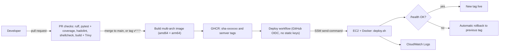
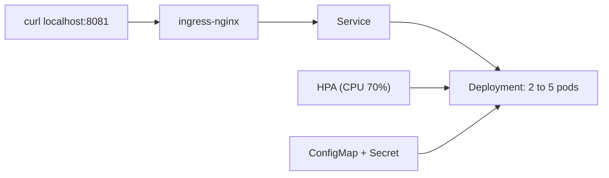
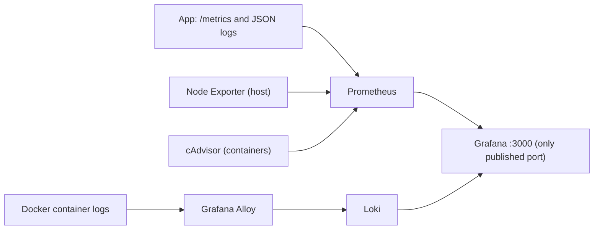
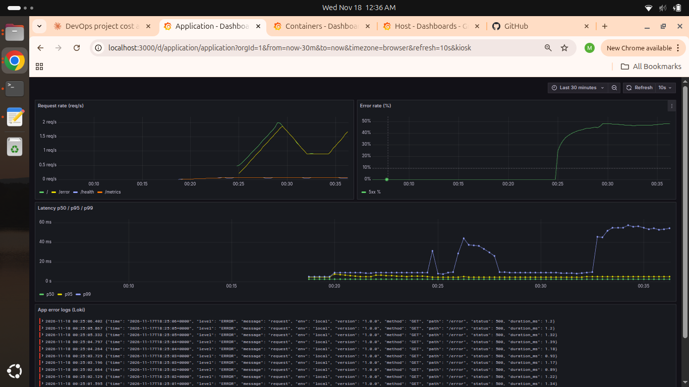
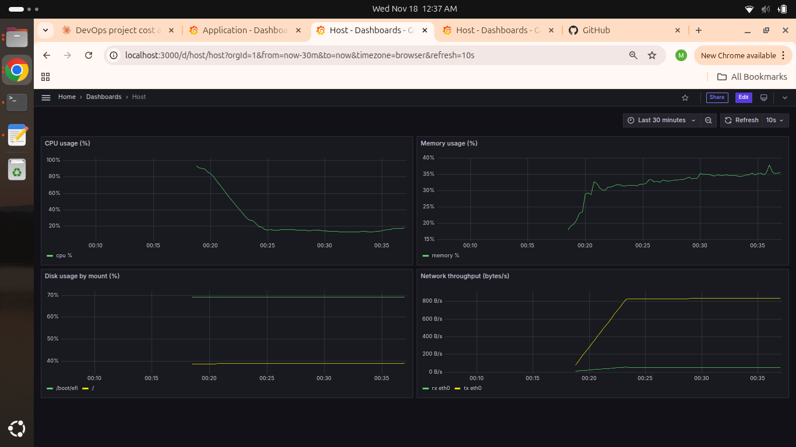
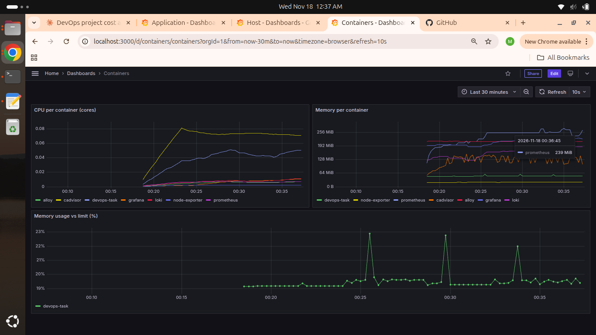
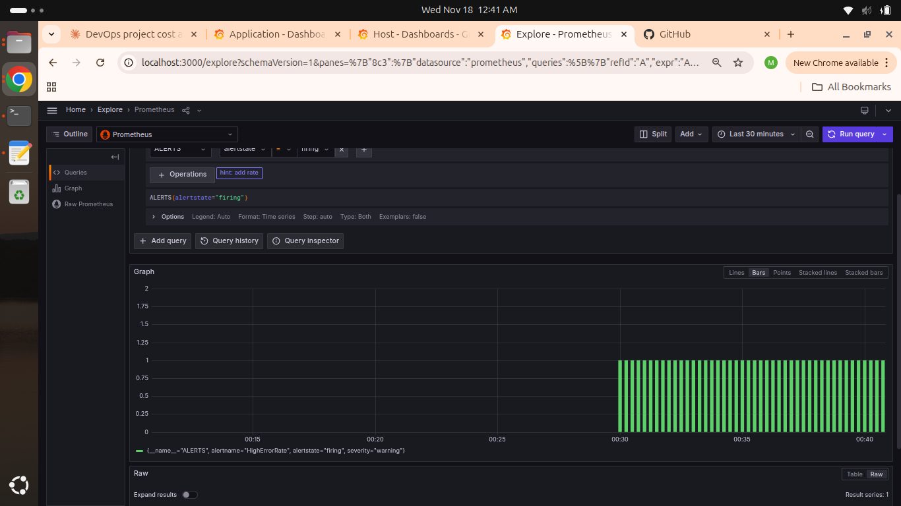
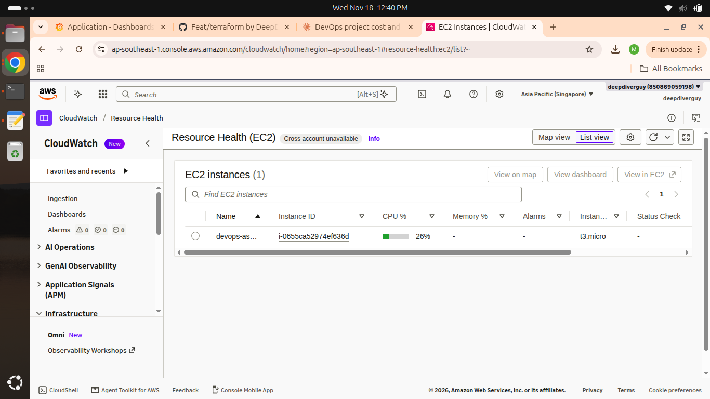
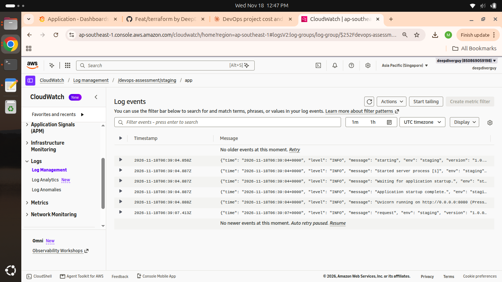

# DevOps Assessment: FastAPI service, CI/CD, Terraform, Kubernetes, Observability

A small FastAPI service taken from source to a containerized, scanned, deployed and monitored state: GitHub Actions CI/CD with a security gate, Terraform-provisioned EC2 on AWS, a local Kubernetes (kind) deployment, a full Prometheus/Grafana/Loki stack, and a Bash health script.

Final image size: **75 MB** (python:3.12.8-alpine3.21, multi-stage, non-root).

## Architecture

### Code to production (CI/CD)



### Kubernetes (kind)



### Observability



## Repository layout

| Path | Contents |
|---|---|
| `app/`, `tests/` | FastAPI service and unit tests |
| `Dockerfile`, `docker-compose.yml` | App image and local run |
| `docker-compose.monitoring.yml`, `monitoring/` | Observability stack, provisioned datasources, dashboards, alert rules |
| `k8s/` | Kubernetes manifests |
| `terraform/` | AWS infrastructure (EC2, IAM, logs) and the GitHub OIDC stack |
| `.github/workflows/` | `pr.yml`, `main.yml`, `deploy.yml` |
| `scripts/` | `system_health.sh` and systemd service/timer |
| `docs/` | Evidence, screenshots, alert reasoning, EKS notes |

## Prerequisites

Docker Engine with the Compose plugin, Python 3.12, `kind` and `kubectl` (for Kubernetes), Terraform and an AWS account (for the AWS part only).

## Run locally

```bash
cp .env.example .env        # set GRAFANA_ADMIN_USER and GRAFANA_ADMIN_PASSWORD
docker compose up -d --build                      # app only, http://localhost:8080
docker compose -f docker-compose.yml -f docker-compose.monitoring.yml up -d --build   # app + monitoring
```

Endpoints: `GET /` (hello JSON), `GET /health`, `GET /metrics`, and `GET /error` (deliberate 500 for the error-spike demo).
Grafana: http://localhost:3000, login with the values from `.env`. Dashboards are in the "Dashboards" menu, provisioned from files.

## Tests and health script

```bash
python -m venv .venv && source .venv/bin/activate
pip install -r app/requirements.txt -r requirements-dev.txt
ruff check . && pytest --cov=app --cov-report=term-missing

scripts/system_health.sh --help
scripts/system_health.sh --disk 80 --cpu 90 --mem 85 --json   # exit code 0 healthy, 1 warning, 2 critical
```

A systemd service and timer (every 5 minutes) are in `scripts/systemd/`.

<!-- end part1 -->

## Observability

Stack: Prometheus (15 day retention), Grafana, Loki (7 day retention), Grafana Alloy, Node Exporter and cAdvisor.
All images are pinned. Data sources and dashboards are provisioned from `monitoring/grafana/`; the dashboard JSON
is generated by the scripts in `tools/` so it stays reviewable.

| Dashboard | Shows |
|---|---|
| Application | request rate per path, 5xx error rate, latency p50/p95/p99, and an ERROR log panel from Loki next to the metrics |
| Host | CPU, memory, disk per mount, network throughput (Node Exporter) |
| Containers | CPU and memory per container, memory usage relative to the configured limit (cAdvisor) |






### Alerts

Rules live in `monitoring/prometheus/rules/alerts.yml`: AppInstanceDown, HighErrorRate, HostDiskUsageHigh,
ContainerMemoryNearLimit and HighP95Latency. The reasoning behind every threshold and `for` duration is in
[docs/alert-reasoning.md](docs/alert-reasoning.md).

### Log labels

Loki labels are only `container`, `service`, `env` and `level`: a few dozen streams at most. `path`, `status` and
`duration_ms` are deliberately not labels, because every distinct value would create a new stream and hurt Loki.
Filter on them at query time instead: `{container="devops-task"} | json | path="/error"`.

### Host access granted to the monitoring containers

| Container | Access | Why |
|---|---|---|
| Node Exporter | `/` mounted read-only, `pid: host` | read real host CPU, memory, disk and network figures |
| cAdvisor | `/`, `/sys`, `/var/run`, `/var/lib/docker` read-only, `/dev/kmsg` | read container cgroup statistics |
| Alloy | Docker socket, read-only | discover containers and read their logs; this is powerful access, reduced by the pinned image, no published ports and an internal-only network |

### Error spike walkthrough

"An error spike appears on the Application dashboard. How do you find the cause?"

1. **Scope it.** On the Application dashboard, check the error-rate panel: when it started, and whether request rate or latency moved with it.
2. **Find where.** The request-rate panel is split by path, so the path that spikes is the first suspect.
3. **Read the evidence.** In the logs panel beside the metrics, the ERROR lines show the path, status and duration. For more detail use Explore with `{container="devops-task", level="ERROR"} | json`.
4. **Rule out resources.** Open the Containers dashboard: memory close to its limit or CPU saturation points at the container. Open the Host dashboard: disk, memory or CPU pressure on the machine.
5. **Check the timeline.** Compare the spike's start with the last deployment; if it matches a release, roll back (see Deployment and rollback).

The full version is in [docs/error-spike-walkthrough.md](docs/error-spike-walkthrough.md).

## Kubernetes (kind)

Manifests in `k8s/`: namespace, ConfigMap, a Secret example (placeholder only; the real Secret is created with
`kubectl create secret` and never committed), Deployment, Service, Ingress (ingress-nginx) and HPA.

- Deployment: 2 replicas, rolling update with `maxUnavailable: 0` and `maxSurge: 1`, liveness and readiness probes on `/health`, CPU and memory requests and limits.
- Security context: non-root (uid 10001), read-only root filesystem, all capabilities dropped.
- HPA: CPU target 70%, between 2 and 5 replicas. On kind, metrics-server needs `--kubelet-insecure-tls`; this is a kind-only workaround.

Cluster and demos:

- Rolling update 1.0.0 to 1.1.0 and `kubectl rollout undo`, with commands and output: [docs/k8s-rollout-demo.md](docs/k8s-rollout-demo.md). During the update and the rollback, 562 requests were sent with 0 non-200 responses.
- HPA under load scaled from 2 to 5 replicas: [docs/k8s-hpa-demo.txt](docs/k8s-hpa-demo.txt).
- How this changes on EKS (ingress controller, secrets management, node autoscaling, IAM roles for service accounts): [docs/k8s-eks-notes.md](docs/k8s-eks-notes.md).

## Terraform (AWS)

`terraform/` provisions one EC2 instance in the default VPC of `ap-southeast-1` with a security group that opens only
the app port (8080) and no SSH, an IAM instance profile limited to SSM core and writing to one CloudWatch log group,
user data that installs Docker and starts the container, a CloudWatch log group with retention, and S3 remote state with
native locking (`use_lockfile`). One codebase serves both environments through `terraform/envs/staging.tfvars` and
`prod.tfvars` (instance size and log retention differ), and each environment has its own state key.

```bash
./scripts/bootstrap_state.sh                      # once: versioned, encrypted, private state bucket
cd terraform
terraform init -backend-config="key=staging/terraform.tfstate"
terraform plan  -var-file=envs/staging.tfvars
terraform apply -var-file=envs/staging.tfvars
terraform output
terraform destroy -var-file=envs/staging.tfvars   # when finished
```

`terraform/oidc/` is a small separate configuration (separate state) that creates the GitHub OIDC provider and the
deploy role, because the OIDC provider exists once per AWS account.

Evidence from the test run:




## CI/CD (GitHub Actions)

| Workflow | Trigger | What it does |
|---|---|---|
| `pr.yml` | pull request | ruff, pytest with a coverage gate of 80%, hadolint, shellcheck, image build and Trivy scan that fails on CRITICAL |
| `main.yml` | push to `main`, tags `v*.*.*` | multi-arch (amd64 and arm64) build with GHA layer cache, push to GHCR with tags `sha-xxxxxxx`, semver and branch name |
| `deploy.yml` | after a successful build, or manually | assume an AWS role through OIDC, run `deploy.sh` on the instance through SSM, then verify `/health` from outside |

Trivy runs from the pinned `aquasec/trivy` container image. The first scan found three CRITICAL OS-package
vulnerabilities, fixed by `apk upgrade` in the final image stage.

### Secrets and variables

No credentials are stored in GitHub. AWS access uses OIDC and short-lived credentials; GHCR login uses the built-in
`GITHUB_TOKEN`. The only configuration is one repository variable, `AWS_ROLE_ARN`
(Settings > Secrets and variables > Actions > Variables), which is an identifier, not a secret.

The deploy role trusts only this repository's `main` branch (GitHub's OIDC subject includes numeric owner and repository
IDs, which keeps it strict) and may only run `AWS-RunShellScript` on instances tagged `Project=devops-assessment`.

## Design decisions

| Decision | Choice | Why, and the trade-off |
|---|---|---|
| Base image | Alpine (python:3.12.8-alpine3.21), multi-stage | Small (75 MB), has a shell and apk for debugging and for `apk upgrade`. Distroless is smaller still and has no shell, but is harder to debug and the Python variants are less flexible. The 75 MB includes about 10 MB from the `apk upgrade` layer that clears CRITICAL CVEs found by Trivy. |
| Deployment target | Single EC2 instance | Simplest thing that meets the brief and is easy to explain and cost. ECS/Fargate removes host management; EKS adds a control plane (about $73/month) that a single small service does not justify. Kubernetes is demonstrated locally on kind instead. |
| Image tags | `sha-<7 chars>` on every main build, `x.y.z` and `x.y` on `v*.*.*` git tags | Deploys use the immutable sha tag, so rollback always points at a known build. `latest` is never relied on. Releases are cut manually by pushing a git tag, which keeps versioning predictable. |
| AWS authentication from CI | GitHub OIDC, role trusted for the `main` branch only | No long-lived AWS keys anywhere. A workflow run from any other branch cannot assume the deploy role. |
| Deploy mechanism | SSM `send-command`, no SSH | No inbound SSH port and no key management; access is controlled by IAM and logged. The security group exposes only port 8080. |
| Secrets | GitHub Variables for non-sensitive values (role ARN), Kubernetes Secret created from the CLI, Grafana credentials from `.env` (gitignored) | Nothing sensitive is committed; only `secret.example.yaml` and `.env.example` with placeholders are in git. Production would use AWS Secrets Manager or SSM Parameter Store. |
| Vulnerability gate | Trivy, fail on CRITICAL, `--ignore-unfixed` | Matches the brief. Unfixed CVEs have no action to take, so they do not block merges. The gate has already caught real findings (openssl, sqlite), which were fixed by patching the base. |
| Loki labels | `container`, `service`, `env`, `level` only | Low cardinality keeps Loki fast and cheap. `path`, `status` and `duration_ms` are not labels; they are parsed at query time with `\| json`. |
| Alert rules | 5 rules in Prometheus | Reasoning per threshold and `for` duration is in [docs/alert-reasoning.md](docs/alert-reasoning.md). |
| Monitoring on the host | Separate `docker-compose.monitoring.yml` | The app runs without the stack. Only Grafana is published; everything else sits on an internal Docker network. |

### Host access granted to monitoring containers

| Component | Access | Why |
|---|---|---|
| Alloy | Docker socket, read-only | Docker service discovery to find containers and read their logs. This is powerful access, mitigated by a pinned image, no published ports and an internal network. |
| Node Exporter | `/` mounted read-only, `pid: host` | Host CPU, memory, disk and network metrics. |
| cAdvisor | `/`, `/sys`, `/var/run`, `/var/lib/docker` read-only, plus `/dev/kmsg` | Per-container CPU and memory metrics. Version 0.55.1 is pinned because older versions could not resolve container names on Docker 29. |

## Deployment and rollback strategy

1. A pull request must pass lint, tests (coverage of at least 80%), hadolint, shellcheck and the Trivy scan before it can be merged.
2. Merging to `main` builds a multi-arch image and pushes it to GHCR with the `sha-` tag.
3. The Deploy workflow starts after a successful build, assumes the AWS role via OIDC and runs `deploy.sh` on the instance through SSM.
4. `deploy.sh` records the previous tag, starts the new container, and smoke-tests `/health` (20 attempts, 3 seconds apart).
5. If the smoke test fails, `deploy.sh` redeploys the previous tag automatically and the workflow fails.

**Rollback was proven**, not just designed: a deliberately broken release (wrong `PORT` baked into the image) failed the smoke test and was rolled back to 1.0.0 automatically. The next deploy, after the revert, was green. Evidence: [rollback run](docs/screenshots/cd-rollback.png) and [green run](docs/screenshots/cd-green.png).

Manual rollback: run the Deploy workflow with the `image_tag` input set to a previous `sha-` or semver tag. On Kubernetes: `kubectl rollout undo` (demonstrated in [docs/k8s-rollout-demo.md](docs/k8s-rollout-demo.md)).

## Security considerations

- **Secrets:** nothing sensitive in git; no static AWS keys (OIDC for CI, instance profile for the instance); `.env` is gitignored.
- **Image scanning:** Trivy on every PR, failing on CRITICAL.
- **IAM:** the instance profile allows only SSM core and CloudWatch Logs. The CI role is trusted only for the `main` branch of this repository.
- **Network:** the security group exposes only port 8080; no SSH; IMDSv2 required. Locally only Grafana (3000) is published.
- **Containers:** non-root user (uid 10001), read-only root filesystem and dropped capabilities on Kubernetes, health checks, resource limits.
- **Terraform state:** S3 bucket is versioned, encrypted and private, with state locking.

## Estimated monthly AWS cost (production, rough)

| Item | Approx. per month |
|---|---|
| EC2 t3.small (on demand) | $15 |
| Public IPv4 address | $4 |
| EBS volume (small gp3) | $1 |
| CloudWatch Logs (low volume, 30-day retention) | $2-5 |
| S3 state bucket | under $1 |
| **Total** | **about $25-30** |

This is an estimate and not a quote. Testing cost was about $0-1 because the resources were destroyed after use. An ALB (about $18-25 more) or EKS (about $73 for the control plane) would add significantly.

## What I would improve with more time

- Alertmanager with Slack or Discord routing, and alerts from `system_health.sh` to a webhook.
- Image signing (Cosign) and SBOM generation in the pipeline.
- HTTPS with a load balancer or Caddy in front of the instance, and an Auto Scaling group for more than one instance.
- Monitoring on the cluster with kube-prometheus-stack, and a Helm chart with staging and production values.
- Dependabot or Renovate for base image and action updates, plus a scheduled rebuild to pick up OS patches.
- Blue/green or canary deploys instead of replace-and-roll-back.
- Moving secrets to AWS Secrets Manager.

## AI usage

I used an AI assistant (Claude) throughout this task for guidance and for drafting configuration, workflows and documentation, working step by step and running and verifying each step myself. I tested the results (tests, scans, deployments, rollback and failure scenarios) and I can explain each part of this submission.
